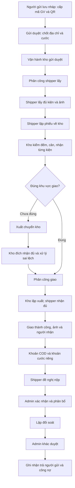

# Thống kê action và luồng hoạt động

Cập nhật ngày 20/11/2026 theo route, Policy, Service và migration đang triển khai. Đây là bảng chức năng của mã nguồn hiện tại; kết quả đã chạy nằm trong [web test QR](web-test-2026-11-19.md) và [kiểm thử chi nhánh, bản đồ shipper](branch-map-test-2026-11-20.md).

## 1. Vai trò và phạm vi

| Vai trò | Phạm vi | Action chính |
| --- | --- | --- |
| Khách chưa đăng nhập | Công khai, kết quả tra cứu rút gọn | Đăng ký, đăng nhập, tính cước, tra cứu mã + 4 số cuối điện thoại nhận |
| Người gửi (`shop`, cá nhân/cửa hàng) | Hồ sơ, vận đơn, khiếu nại, tài chính của mình | Quản lý địa chỉ/ngân hàng; lưu/sửa/gửi/hủy nháp; đề nghị đổi đơn sau duyệt; in tem, tải QR, quét mở đơn; xem thu hộ/đối soát |
| Vận hành (`operations`) | Các kho được gán | Duyệt người gửi theo khu vực; duyệt đơn; phân công/thu hồi; nhập/xuất/chuyển kho; kiểm kê; giao lại/hoàn; xử lý sai lệch, sự cố, khiếu nại |
| Shipper | Nhiệm vụ của mình trong kho còn được gán | Quét mở nhiệm vụ; xem bản đồ, gọi điện/chỉ đường; lấy hàng; lập bàn giao về kho; nhận phiếu xuất; ghi kết quả giao/hoàn và tiền thực thu; đề nghị nộp tiền |
| Admin | Toàn hệ thống, vẫn kiểm tra người lập/người duyệt | Quản lý nhân sự/danh mục/biểu phí, xác minh ngân hàng, giám sát vận hành, xác nhận nộp tiền, đối soát/thanh toán/điều chỉnh, báo cáo và audit |

## 2. Danh mục action

Các dòng dưới là nhóm action nghiệp vụ, không phải số lượng endpoint. Một nhóm có thể gồm trang danh sách, form và nhiều thao tác POST.

| Nhóm | Action / tên route | Điều kiện và kết quả |
| --- | --- | --- |
| Tài khoản | `register.*`, `login.*`, `logout`, `profile.*` | Đăng ký hồ sơ cá nhân/cửa hàng, xác thực, cập nhật thông tin/mật khẩu; tài khoản bị khóa không tiếp tục nghiệp vụ |
| Nhân viên | `users.*` | Admin tạo/sửa nhân viên và kho; không rút quyền shipper còn trách nhiệm hàng/tiền |
| Hồ sơ người gửi | `shop.*`, `pickups.*` | Địa chỉ lấy hàng đang hoạt động, khu vực hợp lệ, tài khoản ngân hàng qua xét duyệt |
| Duyệt hồ sơ | `shops.review`, `banks.verify` | Vận hành theo khu vực/Admin duyệt hồ sơ; Admin xác minh ngân hàng; có lý do và lịch sử |
| Danh mục | `areas.*`, `warehouses.*` | Admin quản lý khu vực/kho; kho đã có nghiệp vụ không đổi khu vực tùy ý |
| Biểu phí | `fees.*` | Lưu dự thảo, sửa, công bố; chặn thời gian chồng lấn; đơn đã gửi giữ snapshot phí |
| Vận đơn | `orders.store`, `orders.update`, `orders.show` | Lưu nháp, sửa theo revision, xem thông tin; cấp mã riêng khi tạo; chống lưu lặp bằng client token + hash |
| Gửi và duyệt | `orders.submit`, `orders.review` | Người gửi xác nhận; server chốt phí/địa chỉ; vận hành duyệt, yêu cầu bổ sung hoặc từ chối |
| Hủy/thay đổi | `orders.cancel`, `orders.change`, `orders.request-cancel`, `orders.change-review` | Trước duyệt có ma trận sửa/hủy; sau duyệt phải đề nghị, người khác xét, có lý do; kiện đã lấy cần thu hồi |
| In và tìm đơn | `orders.index`, `orders.label`, `orders.manifest` | Lọc có phân quyền; một tem/kiện; bảng kê tối đa 100 đơn; pending change chặn in |
| QR | `orders.qr`, `orders.scan`, `orders.scan-resolve` | Hiện/tải PNG, đọc camera/ảnh/thiết bị nhập; chỉ mở hồ sơ hoặc nhiệm vụ trong quyền hiện tại |
| Tra cứu công khai | `shipping.track-form`, `shipping.track` | QR điền sẵn mã; POST vẫn xác minh 4 số cuối; nháp không công khai, không trả PII/COD/lý do nội bộ |
| Điều phối | `logistics.assign`, `logistics.recall`, `logistics.show` | Kiểm tra trạng thái, kho, người giữ, sai lệch và nhiệm vụ đang hiệu lực; có lịch sử phân công |
| Lấy hàng | `logistics.pickup` | Đúng shipper xác nhận thành công/thất bại, tình trạng, ảnh và lý do; thành công tạo kiện và ghi người giữ |
| Bàn giao | `logistics.prepare`, `logistics.confirm`, `logistics.handover` | Lập phiếu chưa đổi người giữ; bên nhận khác người lập kiểm từng kiện rồi xác nhận |
| Tồn và sai lệch | `logistics.inventory`, `logistics.location`, `logistics.resolve`, `logistics.weight-review` | Vị trí tồn, thiếu/hỏng, bằng chứng; lệch cân lập đề nghị tính lại phí, người khác duyệt |
| Chuyển kho | `transfers.store`, `transfers.receive`, `transfers.show` | Kho gửi xuất, kho nhận kiểm từng kiện; người xuất không tự nhận; nhận thiếu vẫn giữ chuyển dở dang |
| Kiểm kê | `stocktakes.store`, `stocktakes.submit`, `stocktakes.approve` | Lập, gửi, người khác duyệt; chênh lệch lưu lịch sử và sai lệch, không tự sửa tồn im lặng |
| Giao/hoàn | `delivery.mine`, `delivery.record` | Chỉ shipper có nhiệm vụ và đang giữ đủ kiện; tên nhận, bằng chứng, thời gian, COD/cước thực thu riêng |
| Bản đồ shipper | `delivery.map` | Lọc lấy/giao/hoàn, tìm mã, phân trang 12 nhiệm vụ; điểm đến theo bước hiện tại; mô phỏng xe chạy trên Leaflet; gọi điện, mở chỉ đường và nhiệm vụ; kiểm tra lại shipper và kho trên mọi request |
| Giao lại/hoàn | `delivery.decide`, `logistics.return` | Vận hành ghi phương án và ý kiến người gửi; giới hạn lượt; thu hồi/nhập lại trước khi gán mới |
| Sổ thu | `delivery.collections`, `finance.collections.show` | Khoản thu gốc theo lần giao, loại COD/cước/phí hoàn; không tạo thu khi giao thất bại |
| Nộp tiền | `finance.deposits.*` | Shipper đề nghị; Admin khác xác nhận thực nhận, bằng chứng, phân bổ; thiếu/thừa có căn cứ |
| Đối soát | `finance.reconciliations.*` | Lập/sửa/gửi/duyệt/trả lại/từ chối/hủy/mở duyệt lại/cập nhật ngân hàng; khóa nguồn tiền chống dùng hai lần |
| Thanh toán | `finance.payments.store` | Đối soát đã duyệt, ngân hàng snapshot hợp lệ, mã giao dịch/bằng chứng, không chi vượt |
| Nợ và thu phí | `finance.fees.show`, `finance.receipts.*` | Theo dõi nghĩa vụ phí và phân bổ tiền thu; không nhập COD thành doanh thu |
| Điều chỉnh | `finance.adjustments.*` | Căn cứ/sự cố/khoản gốc, người khác duyệt; reversal thay sửa/xóa giao dịch đã ghi sổ |
| Sự cố | `incidents.*` | Lập, ghi chú, phân công, khóa, đề xuất kết luận, người khác duyệt; ảnh/căn cứ và lịch sử |
| Khiếu nại | `complaints.*` | Người gửi mở, trao đổi, nhân viên nhận/liên kết sự cố, đóng/mở lại; ẩn trao đổi nội bộ |
| Báo cáo | `reports.*` | Vận hành/tài chính theo quyền và kỳ; xuất Excel/PDF, theo dõi tiến trình/tải link có hạn |
| Audit | `audit.index`, `audit.show` | Admin lọc actor/sự kiện/đối tượng/thời gian, xem before/after; không có action sửa/xóa audit |
| Thông báo | `notifications.*` | Số chưa đọc, danh sách, đánh dấu, mở đối tượng; outbox sau commit, kiểm tra lại phạm vi hiện tại |

## 3. Luồng đơn giao thành công

Mỗi thay đổi trạng thái, custody và tài chính ghi history/audit trong transaction. Tiền thu mới chỉ phát sinh khi ghi kết quả giao/hoàn hợp lệ; quét QR, phân công hoặc chuyển kho không phát sinh thu.

## 4. Các nhánh hoạt động

| Nhánh | Chuỗi hành động | Điều cần giải thích khi demo |
| --- | --- | --- |
| Thiếu thông tin | Nháp → gửi bị validation, hoặc chờ duyệt → cần bổ sung → sửa → gửi lại | Không mất nháp; chỉ gửi khi đủ địa chỉ/kho/người nhận/hàng/cước |
| Bị từ chối | Chờ duyệt → từ chối có lý do → người gửi sửa/gửi lại | Timeline giữ lần xét duyệt cũ |
| Hủy trước lấy | Nháp/chờ duyệt → hủy; đã duyệt → đề nghị hủy → xét duyệt | Chỉ khi chưa lấy kiện; không hủy trực tiếp hàng đang vận chuyển |
| Sửa sau duyệt | Đề nghị → người khác chấp nhận → tính lại phí → chờ duyệt lại | Mã đơn/QR giữ nguyên; pending change chặn in tem |
| Lấy thất bại | Phân lấy → ghi thất bại + lý do/ảnh → điều phối phân lại | Không tạo kiện giả hoặc khoản thu |
| Giao thất bại | Xuất giao → thất bại → shipper bàn giao về kho → kho nhận → quyết định giao lại/hoàn | Người giữ kiện quyết định khả năng phân công, không chỉ status đơn |
| Hoàn nội tỉnh | Quyết định hoàn → xuất hoàn → shipper → người gửi nhận + bằng chứng | Không thu COD; phí hoàn theo snapshot/cách thu đã chọn |
| Hoàn liên tỉnh | Quyết định hoàn → chuyển về kho gốc → kho gốc nhận đủ → xuất hoàn | Phải đúng `origin_warehouse_id`, không gán shipper ở kho sai khu vực |
| Thiếu/hỏng/lệch cân | Kiểm đếm → sai lệch và khóa → bằng chứng → người khác xử lý/duyệt | Không tự coi thiếu thành nhận đủ; lệch cân không tự sửa phí cũ |
| Mất hàng | Sự cố mất → khóa → xác minh/đề xuất → người khác duyệt → cập nhật custody mất | Bồi thường cần căn cứ và duyệt tài chính; không tự sinh trả tiền |
| Khiếu nại | Người gửi mở → vận hành phân công/trao đổi → liên kết sự cố nếu cần → trả lời/đóng | Hồ sơ shop và nội bộ có phạm vi khác nhau |
| Chênh tiền | Ghi thực thu + lý do → giữ xử lý tài chính → xác minh/điều chỉnh được duyệt | COD/cước vẫn tách riêng; request lặp không tạo thêm tiền |

## 5. Mã riêng và luồng QR

- Mã cấp bởi `OrderService::saveDraft()`: `GV` + ULID chữ hoa, ví dụ `GV01M7T85YT19EYZDPQYGAKGQSYZ`. MySQL có unique index trên `orders.tracking_code` từ migration vận đơn.
- Mỗi lần tạo mới hợp lệ có mã riêng. Gửi lại cùng client token và nội dung trả đúng đơn đã lưu; cùng token khác nội dung báo lỗi. Đây là chống tạo trùng, không phải tạo mã mới cho mỗi lần bấm.
- QR là PNG 400×400 do BaconQrCode tạo, chứa `{địa chỉ web}/tra-cuu/{tracking_code}`. Không chứa điện thoại, địa chỉ, số tiền, session hay quyền truy cập.
- Xem/tải QR tại chi tiết đơn; endpoint `/don-hang/{order}/qr` yêu cầu quyền xem. QR có ngay từ nháp, nhưng tra cứu công khai chỉ tìm được đơn đã gửi và xác minh đúng.
- Mỗi tem kiện có barcode và cùng QR của đơn, kèm `Kiện 1/2`, `Kiện 2/2`... Đây là QR theo đơn; không phải mã định danh kiện riêng. COD/tổng thu chỉ thu một lần cho cả đơn.
- Người nhận quét bằng ứng dụng camera điện thoại → trang tra cứu điền mã → nhập 4 số cuối điện thoại → xem trạng thái/timeline công khai.
- Người dùng nội bộ mở **Quét vận đơn** → bật camera, chọn ảnh PNG/JPG/WebP tối đa 5 MB, hoặc nhập mã/nội dung QR bằng máy quét bàn phím → server kiểm tra phạm vi → mở đơn. Shipper được chuyển đến nhiệm vụ còn hiệu lực của mình trong kho còn được gán.
- Ảnh được đọc tại trình duyệt bằng ZXing, không tải lên server. URL ngoài ứng dụng và payload không hợp lệ bị từ chối. Đơn không tồn tại và đơn ngoài quyền dùng cùng thông báo chung.
- Quét không tự duyệt, nhập/xuất, giao hàng hoặc thu tiền. Mỗi action nghiệp vụ vẫn cần xác nhận, Policy, validation, revision/idempotency và lịch sử tương ứng.
- QR giữ nguyên khi đổi thông tin/trạng thái vì mã đơn giữ nguyên; tra cứu đọc trạng thái mới từ database. Không lưu cột/file QR nên đơn cũ tự có QR khi mở, không cần migration/backfill.
- Camera cần HTTPS hoặc localhost và quyền trình duyệt. Khi đưa lên host thật, in/tải lại QR trên tên miền chính thức; URL localhost trong QR demo không dùng được từ điện thoại khác. Thay tên miền cần chuyển hướng tên miền cũ để tem đã in còn hoạt động.

## 6. Thứ tự demo ngắn

1. Người gửi tạo đơn hai kiện, COD 500.000đ, 1.000g nội tỉnh, người nhận trả phí: xem 32.000đ cước và 532.000đ tổng thu; lưu, gửi duyệt, tải QR/in tem.
2. Vận hành đúng kho quét mã, duyệt, phân shipper lấy; thử tài khoản khác kho để thấy không mở được.
3. Shipper quét cùng mã, chỉ thấy nhiệm vụ của mình; lấy đủ hai kiện kèm ảnh rồi lập phiếu về kho.
4. Kho kiểm đủ, cân 500g/kiện, nhập A-01; phân giao, lập phiếu xuất; shipper nhận đủ.
5. Shipper ghi giao thành công với ảnh/người nhận: kiểm tra sổ thu có hai dòng COD và cước, một lần giao.
6. Shipper đề nghị nộp 532.000đ; Admin xác nhận và phân bổ 500.000đ COD + 32.000đ cước; tiền còn giữ bằng 0.
7. Đối soát dùng nguồn COD đã về quỹ; Admin lập/gửi, Admin khác duyệt rồi ghi trả người gửi. Demo này cần hai tài khoản Admin.
8. Quét QR công khai, nhập đúng/sai đuôi điện thoại; kiểm tra đổi trạng thái không đổi mã, sai xác minh không lộ thông tin đơn.

## 7. Luồng bản đồ shipper và phối hợp chi nhánh

Shipper mở **Bản đồ shipper** tại `/ban-do-shipper`, hoặc nút **Bản đồ** trên nhiệm vụ đang thực hiện. Chỉ các nhiệm vụ của chính shipper trong kho còn được gán xuất hiện; ID trên URL không mở rộng quyền. Nhiệm vụ hoàn tất/hủy/thất bại không còn trên bản đồ.

| Loại việc và trạng thái | Điểm tiếp theo |
| --- | --- |
| Lấy hàng, chờ nhận kiện | Địa chỉ người gửi trong snapshot đơn |
| Lấy hàng, đã giữ kiện | Kho phụ trách để bàn giao |
| Giao/hoàn, chưa nhận kiện | Kho phụ trách để nhận hàng |
| Giao hàng, đang giữ kiện | Địa chỉ người nhận |
| Hoàn hàng, đang giữ kiện | Địa chỉ người gửi trong snapshot đơn |
| Đang thu hồi | Kho phụ trách để trả kiện |

Các bộ lọc lấy/giao/hoàn và tìm theo tiền tố mã đơn giữ phạm vi hiện tại. Mở bản đồ hoặc chỉ đường không tự xác nhận bàn giao, giao hàng hay thu tiền. Thiếu địa chỉ hiển thị trạng thái riêng và không tạo URL bản đồ.

Luồng liên tỉnh: vận hành kho gửi xuất chuyển → vận hành kho đích khác người lập kiểm đủ từng kiện → đơn chuyển quyền xử lý sang kho đích → phân shipper thuộc kho đích → lập xuất → shipper nhận đủ → bản đồ đổi từ kho sang người nhận. Chi nhánh thứ ba không mở/nhận chuyến ngoài phạm vi. Tài khoản có hai kho xem được cả hai kho đã gán; cùng tỉnh không tự có quyền kho còn lại.

Bản đồ mở ở **Shipper và điểm nhận**, dùng Leaflet 1.9.4 và nền OpenStreetMap/HOT do OSM France cung cấp. Hiện ngay shipper mẫu, điểm nhận mẫu và tuyến đường trong cùng khung hình, không gọi GPS. **Chạy mô phỏng** cho xe chạy trong 90 giây, có tạm dừng/tiếp tục, về đầu tuyến và xem cả hai điểm. Đổi khu vực đưa tuyến về đầu ở trạng thái sẵn sàng. Vị trí và điểm nhận này là mẫu, không phải tọa độ thực của đơn.

Ba GeoJSON Hà Nội/TP.HCM/Đà Nẵng được chọn ban đầu theo khu vực kho; không gọi dịch vụ tìm đường khi chạy mẫu. Hết tuyến dừng ở “Đã đến điểm nhận mẫu”. Khi chạy, camera bám tâm xe; kéo bản đồ để ngừng bám và nút định tâm để theo xe trở lại. Mục phụ **Vị trí thiết bị (tùy chọn)** chỉ bắt đầu GPS khi bấm **Bật vị trí của tôi**. GPS dừng và xóa tuyến mẫu; chạy mẫu dừng GPS. Khi dùng GPS, hiện độ chính xác, tốc độ và thời điểm; chỉ nhận tọa độ hợp lệ, mới trong 20 giây. Tắt, đổi tab bản đồ, ẩn tab hoặc rời trang đều dừng watchPosition; quay lại không tự bật GPS. Không tự cập nhật trạng thái giao hàng.

Tab **Địa chỉ đơn** mới tải Google Maps nhúng; nút chỉ đường vẫn mở Google Maps theo địa chỉ thực của đơn. Địa chỉ điểm đến được gửi cho Google khi dùng các chức năng này; URL không kèm tên, điện thoại, mã đơn hay số tiền, iframe không gửi referrer. Leaflet tải ô nền theo vùng đang xem từ OSM France; khi bật GPS, ô bản đồ có thể cho nhà cung cấp suy ra khu vực vị trí, không gửi tên/điện thoại/mã đơn. GPS không được lưu hoặc gửi lên server ứng dụng; chưa chia sẻ vị trí cho điều phối, tính tuyến từ GPS tới địa chỉ đơn, theo dõi nền, ETA hoặc tối ưu nhiều điểm. Nền bản đồ cần Internet. Địa chỉ giả trong demo có thể trả kết quả không chính xác ở tab Địa chỉ đơn.
