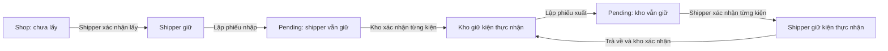

# Sprint 03: Điều phối và quản lý kho

Sau khi gộp vai trò, dùng `operations@guiviet.test` cho cả công việc điều phối và kho. Với kiểm kê do tài khoản này lập, dùng admin hoặc nhân viên vận hành khác để xét duyệt; người lập không được tự duyệt.

Nhánh `sprint-03-dieu-phoi-kho`, nhận Sprint 02 tại `c0a976f`. Phạm vi FR-16 đến FR-24. Khi PR Sprint 02 chưa merge, PR Sprint 03 chứa cả các commit phụ thuộc; review riêng Sprint 03 bằng diff từ nhánh Sprint 02.

## Chức năng nghiệm thu

| FR | Chức năng | Kiểm soát chính |
| --- | --- | --- |
| FR-16 | Phân công lấy/giao/hoàn theo kho, khu vực đơn và tải shipper | Khóa shop → order → task; revision; một active task/đơn bằng generated unique key; shipper active và đúng kho |
| FR-17 | Xác nhận lấy đủ hoặc lấy thất bại | Đúng shipper được giao; ảnh JPG/PNG/WebP tối đa 5MB, tình trạng, lý do; một pickup_attempt/task; thành công tạo đúng N kiện |
| FR-18 | Shipper lập phiếu nhập; kho nhận từng kiện và cân gram | Hai tài khoản hai phía; vị trí đúng kho; phiếu/kiện/tồn/holder/history/audit cùng transaction; không nhận lại kiện đã ở kho |
| FR-19 | Thiếu/hỏng/lệch tổng cân, mức độ, ảnh, hold | Chặn xuất đơn có hold mở; người lập không tự bỏ giữ; lưu lý do và người xử lý; cân thực tế không tự đổi cước |
| FR-20 | Tạo nhiệm vụ giao hoặc hoàn | Đủ kiện tại kho, không hold hoặc đề nghị pending; tối đa 3 lượt giao thực tế; hoàn cần quyết định và căn cứ/ý kiến shop |
| FR-21 | Kho lập phiếu xuất; shipper kiểm đếm thực nhận | Lập phiếu chưa đổi holder; chỉ kiện thực nhận mới chuyển; thiếu tạo sai lệch, kiện không nhận vẫn ở người giữ cũ; xuất thiếu một phần buộc trả phần đã nhận |
| FR-22 | Shipper bàn giao lại về kho, kiểm tra và cân lại | Hết kiện ở shipper mới kết thúc nhiệm vụ cũ; nhận thiếu giữ nhiệm vụ hiệu lực; không gán người mới lúc người cũ còn giữ |
| FR-23 | Snapshot toàn kho/vị trí, kiểm đếm, gửi và xác nhận | Lưu 100 dòng/trang; phải đếm hết; người lập khác người xác nhận; phát hiện custody_version thay đổi; ghi sai lệch, không sửa tồn |
| FR-24 | Thu hồi trước hoặc sau khi nhận kiện | Trước nhận: hủy nhiệm vụ và phiếu xuất pending. Sau nhận: recall_pending, trả đủ kiện rồi mới phân công lại |

## Dữ liệu đã triển khai

- `delivery_tasks`: nhiệm vụ, shipper, kho, trạng thái; active_order_id có giá trị khi assigned/in_custody/recall_pending, unique ngăn hai nhiệm vụ hiệu lực.
- `task_assignments`: sự kiện phân công/thu hồi, actor và lý do. Gán lại tạo task mới, không ghi đè shipper cũ.
- `pickup_attempts`: một kết quả lấy/task. Lấy thất bại không tạo tồn; phân công lần sau là lượt lấy mới.
- `warehouse_items`: một dòng chuẩn cho mỗi `(order_id, parcel_number)`. Holder là shipper hoặc warehouse; holder_user_id chỉ có khi shipper giữ. Chỉ holder_type=warehouse được tính là tồn kho. Cân thực tế và vị trí thuộc từng kiện.
- `handover_documents`, `handover_lines`: hai phía, giờ, lý do, ảnh, kết quả từng kiện và from/to holder. Một pending document/task.
- `discrepancies`: loại, creator/resolver, severity, ảnh, hold và kết luận. Hold gắn một kiện nhưng chặn xuất toàn đơn để không tách vận đơn.
- `warehouse_locations`: mã unique trong từng kho; không xóa vị trí đã tham chiếu.
- `stocktakes`, `stocktake_lines`: snapshot danh sách/custody_version, kết quả đếm, biến động, người lập/xác nhận. Không sửa tồn để làm số đếm khớp sổ.
- `orders`: số lượt giao thực tế và quyết định hoàn. custody_status tổng hợp uncollected/shipper/warehouse/mixed; nguồn chi tiết là từng kiện.
- `order_change_requests`: thêm type measured_weight. Kho gửi số gram đo; điều phối khác xét, tính cước server theo biểu phí hiệu lực lúc duyệt. before_values/history giữ cân/cước cũ. Đơn vẫn tại kho; sau duyệt/từ chối còn phải xử lý hold.

Danh sách phân trang, eager loading; index theo kho/trạng thái, shipper/trạng thái, kho/vị trí/holder và order/hold. Tiền dùng DECIMAL, tính đồng nguyên; kg là chuỗi DECIMAL suy ra từ gram, không dùng float.

## Chuỗi người giữ

Ví dụ hai kiện, kho chỉ nhận kiện 1: kiện 1 ở kho, kiện 2 vẫn do shipper giữ; custody tổng là mixed. Nhiệm vụ chưa kết thúc, không phân công giao mới. Phiếu nhập lần sau chỉ có kiện 2, không nhập lại kiện 1.

## Cách demo

1. Chạy migration, DemoSeeder và DemoOrderSeeder như README, rồi `php artisan db:seed --class=DemoLogisticsSeeder`. Có thêm 7 đơn và một kiểm kê chờ xác nhận; chạy lại không nhân đôi hoặc sửa dữ liệu đã thao tác.
2. Điều phối vào `/dieu-phoi`, chọn đơn chờ, xem khu vực và tải shipper, phân công lấy có lý do. Chưa đổi holder.
3. Shipper mở Nhiệm vụ của tôi, lấy đủ kèm ảnh; hai kiện thuộc mình. Lập phiếu bàn giao về kho.
4. Kho đánh dấu thực nhận từng kiện, nhập gram, chọn A-01. Nhận đủ: task lấy kết thúc, đơn tại kho. Nhận thiếu kèm ảnh: task cũ vẫn hiệu lực.
5. Đơn demo hỏng có hold. Điều phối khác người ghi nhận xử lý có căn cứ tại Tồn kho & sai lệch. Lệch cân cần đổi cước: kho gửi đề nghị, điều phối mở Chi tiết vận đơn để duyệt, rồi xử lý hold. Giữ nguyên cước phải ghi rõ căn cứ thỏa thuận.
6. Điều phối gán giao; kho lập phiếu xuất: holder vẫn tại kho. Shipper nhận đủ: holder sang shipper. Nhận thiếu: kiện không nhận vẫn tại kho, nhiệm vụ chờ trả phần đã nhận.
7. Thu hồi trước nhận: phiếu xuất bị hủy. Thu hồi sau nhận: bắt buộc trả kiện về kho trước nhiệm vụ mới.
8. Kho kiểm kê theo vị trí, lưu từng trang, gửi khi đã đếm hết; điều phối khác xác nhận. Thiếu tạo hold nhưng không xóa tồn. Kiện chuyển sau snapshot được ghi biến động riêng.

Ảnh trong DemoLogisticsSeeder là ảnh kho minh họa có sẵn, không phải bằng chứng giao nhận thực tế. Ảnh upload nằm ngoài public; route xem kiểm tra quyền, private/no-store. Không nhận đường dẫn storage tùy ý từ client.

## Kiểm tra kỹ thuật

- Migration trên database ứng dụng có dữ liệu và database mới `quanlivanchuyen_verify_2026102903`; không migrate:fresh ứng dụng.
- PHPUnit trên `quanlivanchuyen_testing`: 63 bài / 474 assertions đã qua; gồm hồi quy Sprint 01–02 và LogisticsWorkflowTest kiểm tra phạm vi kho/shipper, revision, request lặp, rollback, thiếu/hỏng/cân, hold, ảnh riêng tư, cước, thu hồi và kiểm kê.
- `php tests/Support/logistics-race.php quanlivanchuyen_verify_2026102903`: hai tiến trình MySQL thật. Phân công, lấy, nhập và xuất đều có một accepted/một rejected; cuối cùng đúng hai kiện và hai history xác nhận. Script chỉ nhận tên database verify riêng, để lại fixture kiểm thử tại đó.
- `php vendor/bin/pint --test`, `npm run build`, `php artisan view:cache`, `git diff --check` trước commit.
- Kiểm tra desktop và 390px: phân công, ảnh lấy hàng, bàn giao, kho cân/nhập, tồn kho và menu mobile. Lỗi nghiệp vụ rollback toàn bộ.

## Câu hỏi bảo vệ

**Vì sao nhiệm vụ tách vận đơn?** Vận đơn là cam kết shop/người nhận; task là một lần phân công cụ thể. Thu hồi/gán lại vẫn giữ được trách nhiệm cũ.

**Ai giữ khi phiếu pending?** Bên giao vẫn giữ. Chỉ kiện bên nhận xác nhận thực nhận mới đổi holder.

**Vì sao row lock và unique?** Lock tuần tự hóa nhiều bước; unique là lớp chặn cuối cho active task, pending phiếu và kiện. Revision phát hiện form cũ.

**Cân có tự đổi tiền?** Không. Kho lưu bằng chứng và hold; đổi cước cần measured_weight và người khác duyệt. Phí cũ có trong history. Chưa có khoản thu COD ở Sprint 03.

**Kiểm kê thiếu sao tồn vẫn còn?** Tồn sổ là chuỗi bàn giao; số đếm là bằng chứng cần xác minh. Xóa tồn ngay sẽ mất trách nhiệm. Hệ thống tạo sai lệch và chặn xuất.

**Vì sao không khóa kho suốt kiểm kê?** Người dùng đếm lâu. Snapshot và custody_version phân biệt thiếu thực sự với kiện đã chuyển sau snapshot.

## Ranh giới Sprint 04

Chưa xác nhận giao/hoàn thành công, chữ ký người nhận, thu COD/cước hoặc delivery_collections. delivery_attempt_count chỉ tăng khi Sprint 04 ghi lần giao thực tế; phân công/xuất/trả về không tăng lượt. Chính sách hiện tại tối đa 3 lượt, sau đó cần quyết định hoàn. Phiếu nhập lại ghi căn cứ trả hàng, không tạo lần giao thất bại giả.
