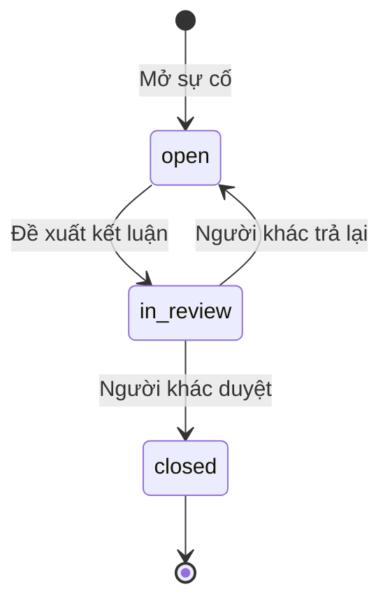

# Sprint 05: Sự cố và khiếu nại

Nhánh `sprint-05-su-co-khieu-nai`, nhận Sprint 04 tại `5c768f5`. Phạm vi FR-30 và FR-31 theo `docs/sprints.json`. PR phụ thuộc Sprint 04 (#4); khi các PR trước chưa merge, diff vào main chứa cả phần phụ thuộc. Review riêng Sprint 05 bằng diff từ nhánh Sprint 04. Chưa triển khai nghiệp vụ Sprint 06.

Theo [ma trận bốn vai trò](role-matrix.md), Vận hành gộp CSKH, điều phối và kho. Người lập/đề xuất không tự duyệt kết luận; dùng Admin hoặc tài khoản Vận hành khác trong phạm vi được giao. Shop chỉ xem hồ sơ của mình, Shipper chỉ báo/xem sự cố trong phạm vi nhiệm vụ.

## Chức năng nghiệm thu

| FR | Đầu ra | Kiểm soát |
| --- | --- | --- |
| FR-30 | `/su-co`: mất/hỏng/sai tiền/thông tin, mức độ, người xử lý, căn cứ và tệp | Chỉ nhân viên đúng quyền/kho; shipper chỉ báo đơn đang được giao và xem hồ sơ do mình lập |
| FR-30 | Khóa lấy/xuất/giao/hoàn và khóa đối soát theo từng sự cố | Kiểm tra lại dưới row lock khi phân công, nhận lấy, lập/xác nhận xuất và ghi giao thành công; vẫn cho ghi thất bại và trả hàng về kho |
| FR-30 | Đề xuất, duyệt/trả lại kết luận, lịch sử và audit | Người lập sự cố và người đề xuất không tự duyệt, kể cả admin; số tiền nguyên VND, DECIMAL; tài chính cần bằng chứng |
| FR-31 | Shop gửi khiếu nại, CSKH tiếp nhận/phân công, trao đổi riêng/công khai | Shop chỉ xem của mình, không tải tệp hoặc đọc ghi chú nội bộ; phân trang sau khi lọc quyền |
| FR-31 | SLA 48 giờ, đánh dấu quá hạn, kết quả xử lý và mở lại | Hạn do server đặt; hàng/tiền cần sự cố có kết luận được duyệt; mở lại trong 7 ngày và giữ SLA gốc |

## Khởi chạy và dữ liệu mẫu

Chọn PHP 8.2+ theo README; không dùng PHP 8.1 mặc định trên máy Laragon này. Sau các seeder của Sprint 01–04:

```shell
php artisan migrate
php artisan db:seed --class=DemoCaseSeeder
npm run build
```

Seeder tạo bốn tình huống qua Service: đang xác minh, chờ duyệt bồi thường, đã duyệt chờ tài chính, khiếu nại chậm giao đã giải quyết. Token cố định nên chạy lại không nhân đôi và không ghi đè hồ sơ đã được demo thao tác. CSKH demo được gán Kho Hà Nội. Ảnh kho chỉ minh họa cho đồ án.

Tài khoản `{shop,operations,shipper,admin}@guiviet.test` dùng mật khẩu đã đặt khi chạy DemoSeeder; không lưu mật khẩu trong mã nguồn. DemoCaseSeeder dùng Vận hành làm người lập và Admin làm người duyệt.

## Quy trình demo

1. Đăng nhập shop, mở `/khieu-nai`, chọn Gửi khiếu nại. Tìm mã vận đơn, chọn đơn của mình, nhập loại/tiêu đề/nội dung và gửi. Hạn xử lý là 48 giờ từ lúc server tiếp nhận.
2. Đăng nhập Vận hành (`operations`), mở hồ sơ để làm công việc CSKH. Phân công người xử lý trong kho; ghi một phản hồi nội bộ và một phản hồi cho shop. Phản hồi công khai đầu tiên mới ghi `first_response_at`; việc phân công không giả lập đã phản hồi shop.
3. Với khiếu nại hàng hỏng/mất/sai tiền, chọn Mở sự cố. Chọn mức độ và phạm vi khóa. Các loại hàng mất/hỏng và sai tiền bắt buộc có tệp. Sai tiền luôn khóa đối soát dù bỏ chọn checkbox.
4. Tùy chọn liên kết kiện, nhiệm vụ, khoản thu hoặc sai lệch kho. Backend từ chối ID thuộc đơn khác, kể cả khi người dùng biết ID thật.
5. Quay lại khiếu nại, chọn sự cố cùng đơn và liên kết có căn cứ. Liên kết đã ghi không được thay thế để che hồ sơ cũ. Lý do nội bộ và tệp của thao tác phân công/liên kết không gửi cho shop.
6. Mở vận hành đơn đang tại kho và có khóa giao: không phân công hoặc xuất được. Nếu sự cố mới xuất hiện sau khi lập phiếu xuất, shipper vẫn không xác nhận nhận kiện được. Nếu đang trên đường thì không ghi giao thành công; vẫn ghi thất bại và bàn giao lại kho được.
7. CSKH ghi nhận xác minh. Đề xuất kết luận: không điều chỉnh tiền (0đ), bồi thường, giảm phí hoặc điều chỉnh tài chính (số tiền dương). Đề xuất tài chính cần bằng chứng trong hồ sơ hoặc tệp mới. Chưa duyệt thì chưa gỡ khóa.
8. Đăng nhập Admin hoặc tài khoản Vận hành khác người lập/đề xuất. Duyệt có căn cứ, hoặc trả lại để xác minh. Bản đề xuất cũ vẫn còn trong lịch sử; trả lại không gỡ khóa. Hai người mở cùng phiên bản chỉ người duyệt đầu tiên thành công.
9. Duyệt không tài chính: đóng xác minh và gỡ khóa của sự cố đó. Duyệt tài chính: đóng xác minh, gỡ khóa giao của sự cố đó, giữ khóa đối soát và hiện Chờ xử lý tài chính. Không thay COD/cước, tạo khoản thu, bồi thường hoặc sửa số dư.
10. CSKH nhập kết quả và giải quyết khiếu nại. Khi tác động hàng/tiền, phải có sự cố liên kết đã được duyệt. Nếu còn chờ tài chính, hệ thống tự thêm câu cảnh báo chưa chi tiền/điều chỉnh vào kết quả gửi shop.
11. Đăng nhập lại shop: thấy phản hồi/kết quả công khai, không thấy diễn biến/tệp nội bộ hoặc hồ sơ sự cố. Thử URL tệp nội bộ bị 403. Có thể mở lại khiếu nại trong 7 ngày, hạn gốc vẫn giữ để phản ánh tổng thời gian xử lý.

## Trạng thái và khóa



`closed` nghĩa là đã duyệt kết luận xác minh. `financial_status=pending_finance` nghĩa là còn chờ chứng từ xử lý ở Sprint 06. Hai trạng thái trả lời hai câu hỏi khác nhau: đã thống nhất kết luận chưa và đã xử lý tiền chưa.

Khóa có nguồn cụ thể trên từng incident. Lệnh bổ sung khóa chỉ tăng phạm vi; không có nút bỏ khóa trực tiếp. Duyệt một hồ sơ không sửa các incident khác, `discrepancies` hoặc `orders.financial_hold`. Quyền xuất còn phụ thuộc đầy đủ kiện, holder, phiếu, nhiệm vụ và đề nghị thay đổi từ Sprint 03–04.

Khiếu nại có `open → in_progress → closed`; phân công chuyển sang đang xử lý. Người có quyền xem được mở lại trong 7 ngày; staff mới được phân công/liên kết/giải quyết. Trạng thái closed vẫn cho tra cứu lịch sử nhưng không cho thêm phản hồi trước khi mở lại. Sau thời hạn mở lại có thể tạo hồ sơ mới để giữ nguyên lịch sử cũ.

## Cấu trúc code và dữ liệu

- `routes/cases.php`, IncidentController/ComplaintController: điều phối request và query có phạm vi; không tính tiền trong controller.
- IncidentRequest/ComplaintRequest và `CaseRules`: validation dùng chung HTTP/Service. Policy kiểm tra vai trò, kho, chủ shop và nhiệm vụ shipper; Service kiểm tra lại sau khi khóa dòng.
- IncidentService/ComplaintService: transaction, revision, workflow, căn cứ và audit. Tạo hồ sơ dùng token + hash nội dung/ảnh; gửi lại đúng request trả hồ sơ cũ, đổi nội dung với token cũ bị từ chối.
- `incidents` và `complaints`: mã ULID unique, creator/assignee, FK restrict, revision. Tiêu đề/nội dung gốc không có endpoint sửa; diễn biến được ghi thêm để truy vết.
- `incident_actions`: action bất biến, proposal/approval trỏ tới lịch sử gốc, `proposed_amount DECIMAL(15,2)` và CHECK không âm. VND xử lý số nguyên đồng; trường này là số đề xuất được duyệt, chưa phải giao dịch tiền.
- `complaint_messages`: ghi thêm, có cờ nội bộ. Shop được lọc ngay trong SQL trước khi phân trang và trước khi load attachments. Căn cứ sự cố không được đẩy sang timeline công khai của đơn.
- `attachments`: đúng một FK cha (action hoặc message), CHECK XOR, SHA-256, MIME và kích thước. JPG/PNG/WebP/PDF tối đa 5 MB; private storage, kiểm tra quyền mỗi lần tải, no-store/nosniff/CSP sandbox. PDF tải xuống; ảnh mở nội tuyến. Rollback/replay xóa file mới không được dùng.
- `config/cases.php`: SLA 48 giờ, thời hạn mở lại 7 ngày. Thời gian lưu UTC, hiển thị Asia/Ho_Chi_Minh.
- Khóa theo thứ tự shop → order → incident/complaint; tạo hồ sơ khóa thêm creator cho token xuyên đơn. Tất cả hành động giao nhận dùng cùng order lock. Khi phân công thắng trước sự cố, task có thể đã tồn tại, nhưng khóa mới chặn lấy/xuất/giao tiếp.

Schema đã chạy nằm trong hai migration `2026_10_29_180000_*` và `2026_10_29_180100_*`; `docs/database-design.md` tách phần đã triển khai khỏi thiết kế dự kiến.

## Kiểm tra kỹ thuật

- Kiểm tra lại mô hình bốn vai trò ngày 05/11/2026: toàn bộ suite 107 bài, 856 assertions đạt. Gồm quyền/kho/shop, bằng chứng, replay, stale revision, duyệt chéo, độc lập khóa, giao nhận tích hợp, SLA, mở lại, nội bộ, rollback file/audit và append-only. Pint và Vite build đạt.
- `php artisan dev:prepare-test-db --database=quanlivanchuyen_verify_2026102905`: migration toàn bộ trên database mới; cũng migrate thành công database ứng dụng có dữ liệu. Không xóa dữ liệu ứng dụng.
- `php tests/Support/case-race.php quanlivanchuyen_verify_2026102905`: hai tiến trình MySQL thật. Replay cùng token tạo một hồ sơ/ảnh; cùng revision chỉ một đề xuất/duyệt/phản hồi; sự cố tranh với phân công vẫn giữ khóa và không cho nhận kiện sau đó.
- `php artisan test`, `php vendor/bin/pint --test`, `npm run build`, `php artisan view:cache`, `git diff --check`.
- Kiểm tra trình duyệt desktop/mobile 375px: shop tạo hồ sơ, CSKH phân công và phản hồi riêng/công khai, đóng hồ sơ; danh sách và chi tiết sự cố, người khác duyệt, hiển thị chờ tài chính; shop không thấy nội bộ. Bảng rộng cuộn trong khung.

## Câu hỏi bảo vệ

**Sự cố và khiếu nại khác nhau thế nào?** Khiếu nại là yêu cầu trao đổi với shop, có SLA và kết quả trả lời. Sự cố là hồ sơ xác minh nội bộ, liên kết hàng/chứng từ, khóa vận hành và kết luận cần duyệt. Một sự cố có thể làm căn cứ cho nhiều khiếu nại cùng đơn.

**Tại sao đóng sự cố rồi vẫn khóa đối soát?** Duyệt kết luận chưa chứng minh đã xử lý tiền. Bồi thường/giảm phí phải có adjustment/chứng từ được duyệt ở Sprint 06; đến lúc đó mới cân nhắc gỡ khóa tài chính qua quy trình có audit.

**Vì sao không dùng một cờ hold chung trên order?** Nhiều nguồn khóa có thể tồn tại cùng lúc. Một cờ chung dễ bị bỏ nhầm khi xử lý một trong nhiều sự cố. Khóa theo hồ sơ giữ được nguồn, người thao tác và căn cứ.

**Tại sao admin không được tự duyệt?** Phân quyền chức năng không thay thế kiểm soát người lập và người duyệt. Tách trách nhiệm giúp ngăn tự hợp thức hóa bồi thường hoặc gỡ khóa do chính mình đề xuất.

**Transaction có chống gửi trùng chưa?** Transaction bảo đảm ghi cùng thành công/rollback. Row lock tuần tự hóa hành động; unique/token/hash nhận biết replay; revision từ chối trang đã cũ. Cần phối hợp cả bốn.

**Chỉ ẩn ghi chú nội bộ bằng Blade đủ chưa?** Chưa. Query phải bỏ nội bộ trước paginate/load; endpoint tải tệp phải xác thực lại quyền của bản ghi cha. Biết URL tệp không đồng nghĩa được tải.

**Vì sao mở lại không reset SLA?** Reset sẽ che thời gian xử lý kéo dài. Giữ hạn ban đầu để quá hạn tiếp tục được ghi nhận; từng lần đóng/mở lại vẫn có diễn biến riêng.

**Khi khóa giao, vì sao vẫn cho nhập lại kho?** Khóa ngăn tiếp tục chuyển hàng cho khách/shop. Trả kiện về kho bảo toàn holder và giúp xác minh; chặn đường trả về sẽ làm hàng mắc ở shipper.

**Số tiền đề xuất có trừ COD không?** Không. COD/cước gốc và khoản thu không đổi. Đề xuất là căn cứ; Sprint 06 mới tạo giao dịch điều chỉnh và phân bổ, không sửa lịch sử để khớp số.

**Giới hạn hiện tại?** Chưa có chi trả/adjustment tự động, gửi email SLA, quét virus hay dịch vụ lưu trữ ngoài. Bảo vệ append-only ở Eloquent vẫn cần quyền DB hạn chế vì SQL trực tiếp có thể vượt qua model. Đây là đồ án local, chưa phải hệ thống tài chính sản xuất.
